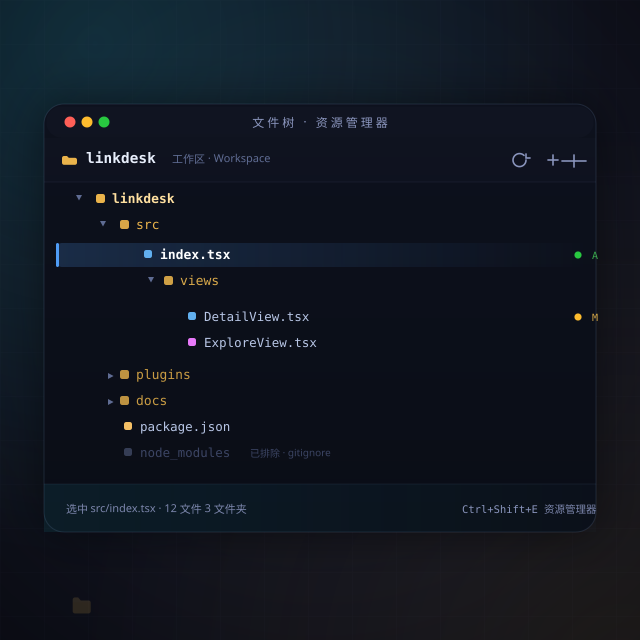

# File Tree

Browse and manage files — modeled on the VS Code Explorer



## What it does

- Sidebar / panel surfaces: Explorer.
- 23 commands, available from the Command Palette and the Plugin Store's Features tab.
- 18 settings, editable in Settings.

## Views

- **Search**
- **Open Folder**

## Commands

| Command | What it does |
|:--|:--|
| `file-tree.revealInExplorer` — Reveal in File Tree | Expand the matching directory chain in the file tree, select the target, and scroll it into view. Pass filePath or uri; omit both to use the focused item. No effect when the target is not inside any open workspace. |
| `file-tree.newFile` — New File | Create an empty file in the target directory. On a name clash, add a numeric suffix according to file-tree.incrementalNaming (smart by default; test.txt → test-1.txt). The target is the context-menu item's directory (the folder itself or the file's parent), falling back to the focused item or the first workspace root. |
| `file-tree.newFolder` — New Folder | Create a folder in the target directory. Naming and target-directory fallback follow New File. |
| `file-tree.openFile` — Open | Open a pinned tab using the plugin that owns the file extension. Expects a context-menu item (FileMenuContext); directories are ignored. |
| `file-tree.openToSide` — Open to the Side | Open the file in the editor as a pinned tab. Currently uses the same tab-opening path as Open and does not guarantee a split pane. Directories are ignored. |
| `file-tree.openWith` — Open With... | Superseded by the host command `workbench.action.openWith` (the host owns the picker and data assembly). Kept only for transition compatibility: it normalizes the argument (bare path / { uri, anchor } / { uri, ext } / { ext }) into a host request and forwards it; the host normalizes the extension. New code should call the host command directly (`SHELL_COMMANDS.openWith` / `openWith()` from `@linkdesk/plugin-sdk/shell-commands`). |
| `file-tree.openFocused` — Open Focused Item | Act on the focused item: expand/collapse a directory, or open a file in a tab. Equivalent to pressing Enter in the file tree. No effect without a focused item. |
| `file-tree.openInTerminal` — Open in Terminal | Open the target directory in an external terminal (for a file, use its parent directory). The terminal type comes from file-tree.external.windowsExec; when set to custom, the launch command comes from file-tree.external.customCommand ({{dirPath}} is the directory placeholder). |
| `file-tree.revealInOS` — Reveal in File Explorer | Reveal and select the item in the system file manager (Windows Explorer). Requires a context-menu item (FileMenuContext); no effect without uri. |
| `file-tree.copyPath` — Copy Path | Copy the item's full path to the system clipboard. Requires a context-menu item (FileMenuContext); no effect without uri. |
| `file-tree.copyRelativePath` — Copy Relative Path | Copy the path relative to its workspace root to the system clipboard; falls back to the full path when no root matches. Requires a context-menu item (FileMenuContext). |
| `file-tree.cut` — Cut | Cut: record the selection in the plugin clipboard and also put the paths on the system clipboard file list (pasteable in Explorer). Acts on the current multi-selection, falling back to the context-menu item, then the focused item. |
| `file-tree.copy` — Copy | Copy: the same dual write as Cut (plugin clipboard + system clipboard), but Paste copies instead of moving. Target resolution matches Cut. |
| `file-tree.paste` — Paste | Paste clipboard paths into the target directory: cut entries move, copied entries copy, and name clashes follow the same safety flow as drag-and-drop. The target is the context-menu item's directory or the focused item's directory, falling back to the first workspace root. |
| `file-tree.rename` — Rename | Start inline rename on the focused row (same as F2). No effect without a focused item. |
| `file-tree.delete` — Delete | Delete the current selection; without a multi-selection, use the context-menu item, then the focused item. When file-tree.confirmDelete is true (the default), confirm first. Items are deleted and failures reported one by one; only successfully deleted items refresh their parent directory. |
| `file-tree.findInFolder` — Find in Folder... | Placeholder command: not implemented; invoking it has no effect. |
| `file-tree.refresh` — Refresh Explorer | Re-read all workspace roots and reload the children of expanded directories (collapsed levels are left untouched). |
| `file-tree.collapseAll` — Collapse All Folders | Collapse every expanded directory in the file tree. This only changes view state and never touches disk. |
| `file-tree.closeAllEditors` — Close All Editors | Close every editor tab in all groups (forwards the shell command core.closeAllEditors). File-tree expansion and selection are untouched. |
| `file-tree.openFolder` — Open Folder... | Show the system folder picker and add the selected folder to the workspace. |
| `file-tree.search` — Search | Move focus to the search panel's input (the panel lives in the file-tree sidebar; this command neither switches views nor runs a search—the user supplies the query). |
| `file-tree.openSearchResult` — Open Search Result | Open a search result row (same as double-clicking it): open a tab via the plugin that owns the extension. By default opens the highlighted row; optionally pass filePath (and lineNumber). Requires existing search results, otherwise it errors. |

## Settings

- **Sort Order** (`file-tree.sortOrder`) — File tree sort order
- **Compact Folders** (`file-tree.compactFolders`) — Compact folders — compress single-child directories into a combined path
- **Auto-Expand Root** (`file-tree.expandSingleFolderWorkspaces`) — Auto-expand root node when opening a folder
- **Color Decorations** (`file-tree.decorations.colors`) — File decorations — color markers
- **Badge Decorations** (`file-tree.decorations.badges`) — File decorations — badge markers
- **Expand on Click** (`file-tree.expandOnClick`) — Click directory rows to expand/collapse — when off, only the twistie triangle handles expand/collapse, clicking selects only
- **Auto Reveal** (`file-tree.autoReveal`) — Auto-reveal in file tree when switching editor tabs
- **Open Dropped File** (`file-tree.autoOpenDroppedFile`) — Auto-open files after dragging from file explorer
- **Auto-Number Duplicates** (`file-tree.incrementalNaming`) — Auto-add numeric suffix for duplicate file names (e.g. test-1.txt)
- **Enable Drag & Drop** (`file-tree.enableDragAndDrop`) — Enable file tree drag and drop
- **Confirm Delete** (`file-tree.confirmDelete`) — Show confirmation dialog before deleting files/folders
- **Confirm Drag & Drop** (`file-tree.confirmDragAndDrop`) — Show confirmation dialog before drag-and-drop file moves
- **Respect .gitignore** (`file-tree.excludeGitIgnore`) — Read .gitignore to exclude files
- **Exclude Patterns** (`file-tree.exclude`) — Glob patterns to exclude files/folders
- **File Nesting** (`file-tree.fileNesting.enabled`) — File nesting — collapse related files as children of the parent file
- **Expand Nested Folders** (`file-tree.fileNesting.expand`) — File nesting expanded by default
- **External Terminal** (`file-tree.external.windowsExec`) — External terminal for "Open in Terminal". Select "Custom" to enter a launch command in the template below.
- **Custom Terminal Command** (`file-tree.external.customCommand`) — Custom terminal launch command. Use {{dirPath}} as the target directory. E.g.: wt -d "{{dirPath}}"

## Command error codes (AI / scripts)

Expected failures of write commands use the returned structured envelope `{isPluginError:true, code, message, hint?, details?}` (never a bare throw or a Chinese-only message), so callers can branch on `code`.

| code | Meaning | Next step |
|:--|:--|:--|
| `EBADARGS` | Invalid arguments / `rename` received only one of `uri` and `newName` | Pass both (programmatic) or neither (inline) |
| `EEXIST` | `rename` target already exists (never overwritten) | Choose another name, or remove/move the target first |
| `EFS` | Host filesystem operation failed (locked/permission/source missing) | Read `message`; run `file-tree.refresh` to re-check |
| `ECONFLICT` | `expectedVersion` does not match the current `stateVersion` | Run `file-tree.refresh` for the latest version, then retry |
| `ENOVIEW` | Argument-less `rename` is inline rename, but no file-tree view is mounted | Pass `uri`+`newName` for programmatic rename, or open-tab file-tree first |

> `ENOVIEW` is a **plugin-level semantic code**. The shell's `EVIEWREQUIRED` (for view-scoped commands) is a different path — they are **not synonyms** and do not replace each other.

## Install

Open the Plugin Store, find this plugin, and click Install. For offline use, install the `.linkdesk-plugin` package from disk.

## Development

```bash
npm install
npm run dev      # preview in the dev host
npm run lint     # eslint + manifest i18n completeness
npm run verify   # full repository gate
npm run build    # produce the .linkdesk-plugin package
npm run publish  # GitHub Release + catalog entry
```

See the repository root `README.md` for the Chinese documentation and the full directory contract.
